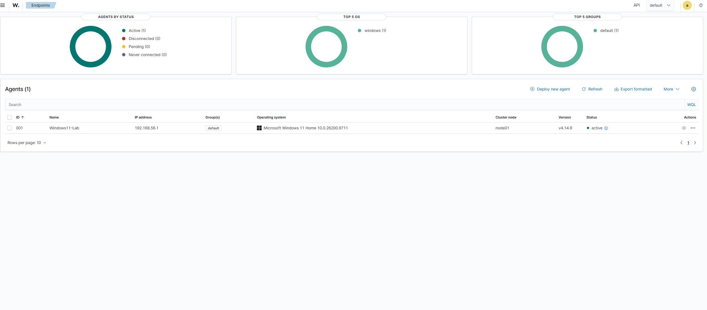
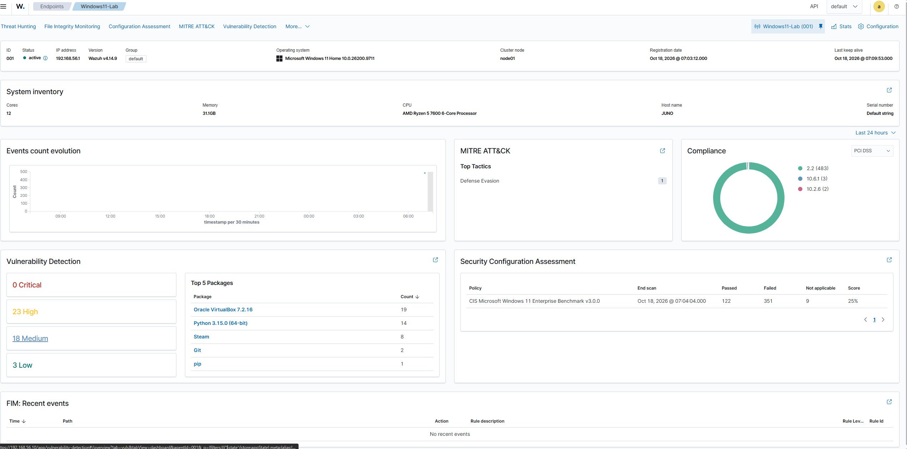
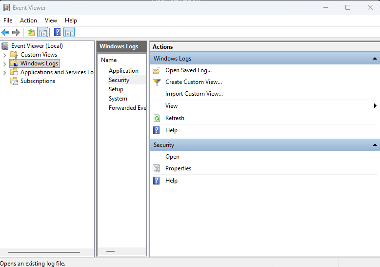
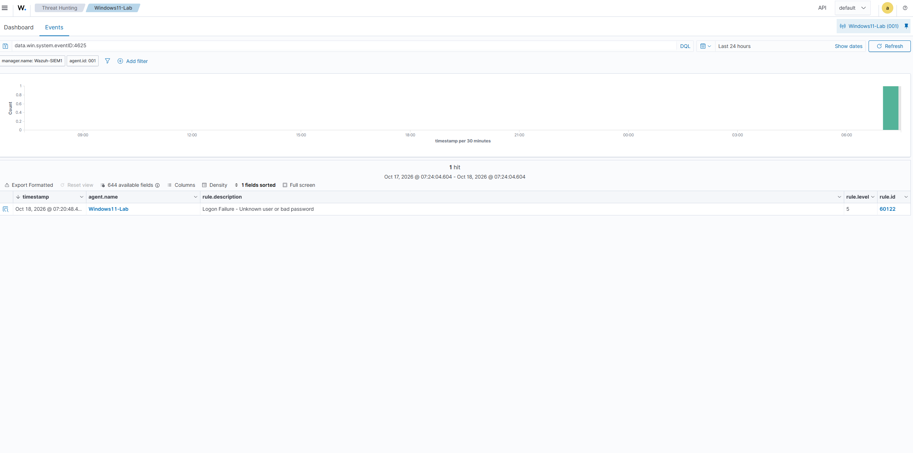
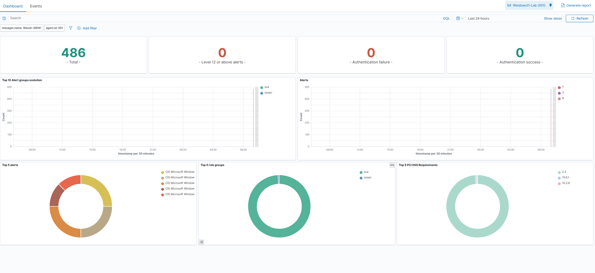
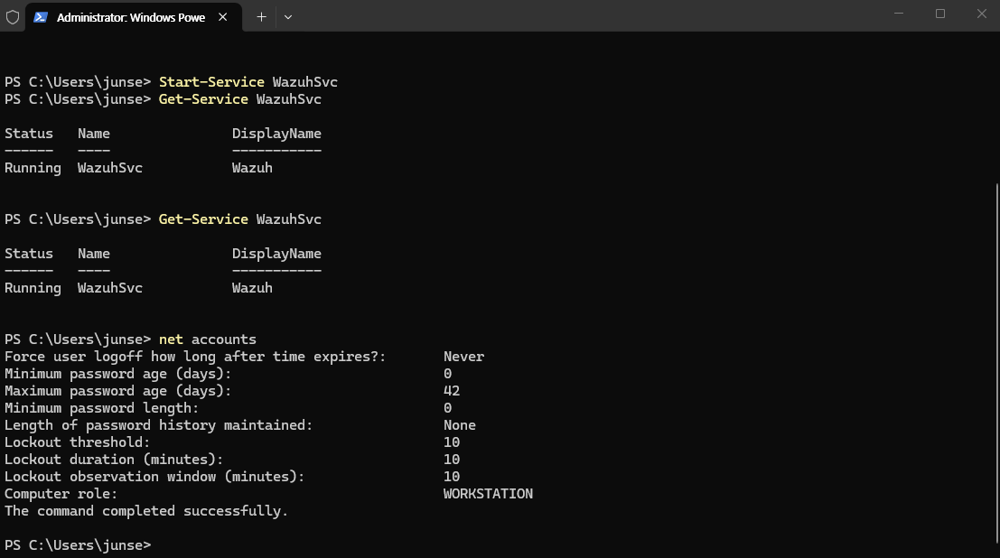
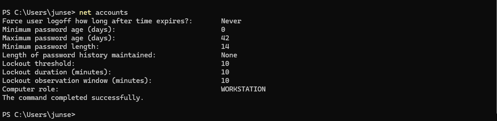
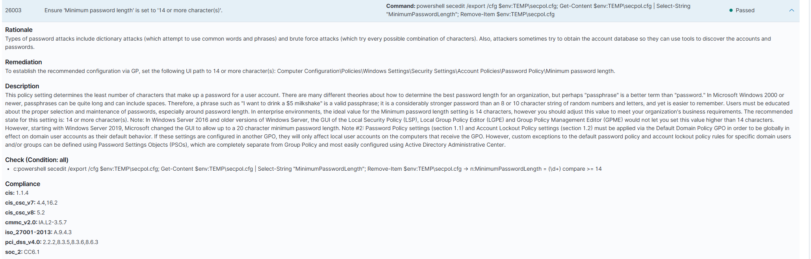

# Wazuh SIEM – Security Monitoring Lab


I built this lab to get hands-on experience with security monitoring, log analysis, and endpoint security using Wazuh SIEM.
For this project, I deployed Wazuh on an Ubuntu virtual machine and connected my Windows pc as a monitored endpoint. Then I generated a failed login and investigated through windows event viewer and wazuh. Lastly I performed a security configuration assessment based on CIS benchmarks

## Lab Environment

| Component | Description |
|---|---|
| SIEM Platform | Wazuh |
| SIEM Server | Ubuntu Linux VM |
| Monitored Endpoint | my PC(windows)|
| Endpoint Agent | Wazuh Agent v4.14.9 |
| Virtualization | Oracle VirtualBox |

## 1. Connection to Endpoint

I started by installing and configuring the Wazuh agent on my PC.

After connecting the agent to the Wazuh server, I verified that the endpoint appeared as active in the dashboard.

This screenshot confirms that the agent was communicating with the SIEM server and could send security information for analysis.



I also explored the endpoint overview to see the security information Wazuh was collecting, including vulnerability detection and security configuration assessment results.



## 2. Investigation of failed login


I enabled success and failure auditing for Windows logon events and generated a failed login attempt using PowerShell:

```powershell
runas /user:%COMPUTERNAME%\FakeTestUser cmd
```

After entering an incorrect password, Windows rejected the login attempt.

I opened Windows Event Viewer and found the corresponding security event.

**Event ID 4625 — An account failed to log on**




Next I opened Wazuh Threat Hunting and searched for the event using:

```text
data.win.system.eventID:4625
```

Wazuh successfully collected the event from my Windows endpoint and generated an alert.

The alert included:

- **Event ID:** 4625
- **Rule ID:** 60122
- **Rule Level:** 5
- **Description:** Logon Failure – Unknown user or bad password



This demonstrated how Windows security logs can be forwarded to a centralized SIEM and used to investigate authentication failures.

## 3. Security Configuration Assessment

I also used Wazuh's Security Configuration Assessment (SCA) feature to evaluate my Windows computer against the CIS Microsoft Windows Benchmark.

The initial assessment produced the following results:

| Result | Number |
|---|---:|
| Passed | 122 |
| Failed | 351 |
| Not applicable | 9 |
| Total checks | 482 |
| Initial score | 25% |



The assessment highlighted multiple settings that did not meet the benchmark recommendations.


## 4. Identifying a Weak Password Policy

I chose minimum password length to fix for this project.

**CIS Check 26003:** Ensure that the minimum password length is set to 14 or more characters.

Wazuh initially marked this check as failed.


To investigate, I opened PowerShell and ran:

```powershell
net accounts
```

The results showed that the minimum password length was set to **0 characters**.




## 5. fixing and Verifying the Finding

I updated the Windows password policy to require a minimum of 14 characters.

After making the change, I ran `net accounts` again to confirm that the new setting was applied.




I then checked the corresponding security configuration assessment result in Wazuh.

The previously failed check was now marked as **Passed**.



## 6. Skills I learned


